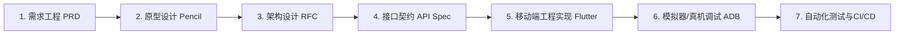

# 移动端短视频全生命周期开发流程与工具链审查报告

本报告针对**抖音移动端（iOS / Android）完整软件工程研发流程**，对当前开发机（Windows 11）的环境工具进行了全面盘点与诊断。

---

## 一、 软件工程标准化流程阶段映射



| 流程阶段 | 对应产出物 | 当前状态 |
| :--- | :--- | :--- |
| **阶段 1：需求工程** | [PRD_DOUYIN_MOBILE.md](file:///c:/Users/Admin/Desktop/DouYin/PRD_DOUYIN_MOBILE.md) | ✅ 已完成并锁定 |
| **阶段 2：UI/UX原型** | [douyin_mobile_prototype.pen](file:///c:/Users/Admin/Desktop/DouYin/douyin_mobile_prototype.pen) | ✅ 已生成，Pencil可直接打开 |
| **阶段 3：技术选型与RFC** | [ARCHITECTURE_MOBILE_RFC.md](file:///c:/Users/Admin/Desktop/DouYin/ARCHITECTURE_MOBILE_RFC.md) | ✅ 已完成架构决策 |
| **阶段 4：接口契约设计** | [api_contract.yaml](file:///c:/Users/Admin/Desktop/DouYin/api_contract.yaml) | ✅ 符合 OpenAPI 3.0 规范 |
| **阶段 5：原型可视化体验** | 网页端内置「📱 iPhone 移动端真机视图模式」 | ✅ 实时预览与触控滑动 |

---

## 二、 当前机器已具备的工具清单 (Ready)

| 工具名称 | 检测路径 / 版本 | 说明 |
| :--- | :--- | :--- |
| **Pencil & Pen CLI** | `C:\Users\Admin\AppData\Roaming\npm-global\pencil.cmd` | ✅ 已配置进全局 PATH，命令行 `pencil` 和 `pen` 均可直接运行 |
| **Pencil 桌面端** | 本地已安装 | ✅ 直接双击打开 `.pen` 原型文件进行画布拖拽与编辑 |
| **Flutter SDK** | `E:\flutter` (版本 3.24.5 Channel stable) | ✅ 最成熟的跨平台高性能渲染框架 |
| **Android SDK** | `C:\Users\Admin\AppData\Local\Android\Sdk` (API 34) | ✅ 包含 build-tools 与 platform-tools |
| **ADB 调试桥** | `adb.exe` 守护进程正常启动 | ✅ 用于真机与模拟器通信 |
| **Node.js & npm** | `Node v22.22.0` / `npm 10.9.4` | ✅ 前端与原型工程化基石 |
| **Python** | `C:\Python312\python.exe` (Python 3.12) | ✅ 算法模型与后端脚本工具 |
| **Git** | `C:\Program Files\Git\cmd\git.exe` | ✅ 版本控制工具 |
| **Docker** | `C:\Program Files\Docker\Docker\resources\bin\docker.exe` | ✅ 微服务与中间件容器化基础设施 |

---

## 三、 当前环境缺少 / 需要补齐的工具与解决指南 (Missing & Action Needed)

### 1. ⚠️ Android SDK 许可证未签署 (Licenses not accepted)
- **现象**：Flutter 检测到未同意 Android SDK 许可，会导致首次编译 Android apk 时报错。
- **一键补齐命令**：
  ```powershell
  flutter doctor --android-licenses
  # 一路输入 y 回车即可全部签署
  ```

### 2. ⚠️ 缺少运行中的 Android 模拟器或物理机连接
- **现象**：当前 `adb devices` 列表为空，没有连接可用于热重载的真机或 AVD。
- **推荐补齐方案**：
  - **方案 A（最便捷）**：用 USB 数据线连接安卓手机，在手机开发者选项中开启「USB 调试」；
  - **方案 B**：安装并启动 Android 模拟器（如 Android Studio AVD、MuMu模拟器或雷电模拟器开启调试端口）；
  - **方案 C（即刻体验）**：在浏览器中使用我们为你构建的 **「iPhone 15 Pro 移动端仿真视口」**，无需任何模拟器即可直接体验 9:16 沉浸手势！

### 3. ⚠️ 缺少 JDK 17 (Java Development Kit)
- **现状分析**：系统当前引用的 Java 是旧版 Oracle Java。现代 Android Gradle 8+ 强制要求 JDK 17。
- **补齐方式**：
  ```powershell
  # 推荐使用 winget 快速安装 Microsoft OpenJDK 17
  winget install Microsoft.OpenJDK.17
  ```

### 4. ℹ️ Pencil CLI 终端云端认证 (可选)
- **说明**：要在终端无头调用 `pencil --prompt "..."` 利用 AI 生成设计，需要先在终端完成一次登录：
  ```bash
  pencil login
  ```
  *(注：如果直接在本地 Pencil 桌面端查看和画图，则不需要登录 CLI)*。
